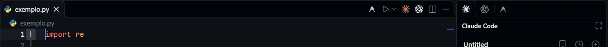

<a id="readme-top"></a>

<!-- PROJECT SHIELDS -->
<div align="center">

[![Contributors][contributors-shield]][contributors-url]
[![Forks][forks-shield]][forks-url]
[![Stargazers][stars-shield]][stars-url]
[![Issues][issues-shield]][issues-url]
[![License: MIT][license-shield]][license-url]
[![LinkedIn][linkedin-shield]][linkedin-url]

</div>

<!-- PROJECT HEADER -->
<br />
<div align="center">
  
  <h1 align="center">Agy Button</h1>

  <p align="center">
    <strong>A button in the VS Code editor toolbar that opens the Antigravity (agy) panel with one click.</strong>
    <br />
    <em>It sits next to the Claude Code and Codex buttons, so you can switch between the three agents without hunting for an icon in the side bar.</em>
    <br />
    <br />
    <a href="#getting-started">Getting Started</a>
    &middot;
    <a href="#usage">Usage</a>
    &middot;
    <a href="#development">Development</a>
    &middot;
    <a href="docs/PUBLISHING.md">Publishing</a>
    &middot;
    <a href="https://github.com/alissonpef/vscode-agy-button/issues">Report an issue</a>
  </p>
</div>

<!-- TABLE OF CONTENTS -->
<details>
  <summary><strong>Table of Contents</strong></summary>
  <ol>
    <li>
      <a href="#about-the-project">About the Project</a>
      <ul>
        <li><a href="#the-problem">The Problem</a></li>
        <li><a href="#the-solution">The Solution</a></li>
        <li><a href="#key-features">Key Features</a></li>
        <li><a href="#built-with">Built With</a></li>
      </ul>
    </li>
    <li><a href="#getting-started">Getting Started</a></li>
    <li><a href="#usage">Usage</a></li>
    <li><a href="#repository-structure">Repository Structure</a></li>
    <li><a href="#development">Development</a></li>
    <li><a href="#contributing">Contributing</a></li>
    <li><a href="#license">License</a></li>
    <li><a href="#contact">Contact</a></li>
    <li><a href="#acknowledgments">Acknowledgments</a></li>
  </ol>
</details>

---

## About the Project

### The Problem

> If you use more than one AI agent in VS Code (Claude Code, Codex and Antigravity), your icons end up scattered: Claude and Codex add a button to the editor toolbar, but Antigravity only shows up as an icon in the side bar, far from the other two.

### The Solution

> **Agy Button** adds an Antigravity button to the same toolbar, to the left of the others. One click opens or focuses its panel, whether it lives in the left or the right side bar.

<p align="center">
  
  <br />
  <em>The Agy Button (leftmost icon in the toolbar), next to the Claude Code and Codex buttons.</em>
</p>

### Key Features

- **Editor toolbar button:** an icon next to the other agents' buttons, with light and dark theme variants.
- **Opens the panel wherever it is:** it works even if you moved the Antigravity panel to the right side bar.
- **Command palette entry:** `Agy Button: Open Agy Panel` (`Ctrl+Shift+P`), for keyboard users or to bind a shortcut.
- **Clear error message:** if the Antigravity extension is missing or disabled, a message tells you what to do.
- **Light and safe:** no runtime dependencies, it never runs workspace code, and it works in untrusted workspaces.

> **Disclaimer:** "Antigravity" and its logo are trademarks of their respective owners. This project is independent and is **not affiliated with, sponsored by or endorsed by** them. The logo is used only to identify the product the button opens.

### Built With

- [![JavaScript][javascript-shield]][javascript-url]
- [![VS Code][vscode-shield]][vscode-url]
- [![Node.js][node-shield]][node-url]

<p align="right">(<a href="#readme-top">back to top</a>)</p>

---

## Getting Started

### Prerequisites

- VS Code **1.90** or newer.
- The **Antigravity** extension (`google.google-antigravity`), installed from the Marketplace. It is declared as a dependency, so VS Code installs it together with this extension.

### Installation

**From the Marketplace** (once published), search for **Agy Button** or run:

```bash
code --install-extension alissonpef.agy-button
```

**From source or a `.vsix` file:**

```bash
# Clone the repository
git clone https://github.com/alissonpef/vscode-agy-button.git

# Enter the directory
cd vscode-agy-button

# Install the development dependencies
npm install

# Build the package and install it in VS Code
npm run package
code --install-extension agy-button-0.1.0.vsix
```

<p align="right">(<a href="#readme-top">back to top</a>)</p>

---

## Usage

1. Open any file in the editor.
2. Click the **agy icon** in the top-right corner of the tab bar, to the left of the Claude and Codex buttons.
3. The Antigravity panel opens or receives focus.

From the command palette: press `Ctrl+Shift+P` and type **Agy Button: Open Agy Panel**. To bind a shortcut, open **Preferences: Open Keyboard Shortcuts** and search for `agyButton.open`.

<p align="right">(<a href="#readme-top">back to top</a>)</p>

---

## Repository Structure

```text
├── .vscode/
│   └── launch.json          # F5 configuration to debug the extension
├── docs/
│   └── PUBLISHING.md        # Step-by-step guide to publish to the Marketplace
├── media/
│   ├── icon.png             # Marketplace icon (128x128)
│   ├── agy-dark.svg         # Button icon for dark themes
│   └── agy-light.svg        # Button icon for light themes
├── .gitignore
├── .vscodeignore            # What stays out of the published package
├── CHANGELOG.md             # Version history (Keep a Changelog + SemVer)
├── LICENSE                  # Software license (MIT)
├── README.md                # This page
├── extension.js             # Extension code
└── package.json             # Manifest: command, menu, dependencies and Marketplace metadata
```

<p align="right">(<a href="#readme-top">back to top</a>)</p>

---

## Development

```bash
# 1. Install dependencies
npm install

# 2. Check the code syntax
npm run check

# 3. Run the extension in a test window: open the folder in VS Code and press F5

# 4. Build the .vsix package
npm run package
```

The code has a single responsibility: when it receives the `agyButton.open` command, it tries `antigravity.panel.focus` and, if that command does not exist in the installed version, `antigravity.toggleChatFocus`. If neither works, it shows an error message.

To release a new version, follow [docs/PUBLISHING.md](docs/PUBLISHING.md).

<p align="right">(<a href="#readme-top">back to top</a>)</p>

---

## Contributing

Contributions are welcome! Follow the flow below:

1. Fork the project
2. Create a branch for your change (`git checkout -b feature/MyFeature`)
3. Run `npm run check` and test with F5
4. Make an atomic commit (`git commit -m 'feat: add XYZ support'`)
5. Push to your fork (`git push origin feature/MyFeature`)
6. Open a **Pull Request**

### Contributors:

<a href="https://github.com/alissonpef/vscode-agy-button/graphs/contributors">
  
</a>

<p align="right">(<a href="#readme-top">back to top</a>)</p>

---

## License

Distributed under the **MIT** license. See the [LICENSE](LICENSE) file for more information.

<p align="right">(<a href="#readme-top">back to top</a>)</p>

---

## Contact

**Alisson Pereira Ferreira**

- Email: [alissonpef@gmail.com](mailto:alissonpef@gmail.com)
- LinkedIn: [linkedin.com/in/alisson-pereira-ferreira](https://www.linkedin.com/in/alisson-pereira-ferreira/)
- GitHub: [@alissonpef](https://github.com/alissonpef)

Repository: [https://github.com/alissonpef/vscode-agy-button](https://github.com/alissonpef/vscode-agy-button)

<p align="right">(<a href="#readme-top">back to top</a>)</p>

---

## Acknowledgments

- **Othneil Drew** — For the well-known [Best-README-Template](https://github.com/othneildrew/Best-README-Template/tree/main), the base of this README.
- **The VS Code team** — For the [extension API documentation](https://code.visualstudio.com/api) and the [`vsce`](https://github.com/microsoft/vscode-vsce) tool.

<p align="right">(<a href="#readme-top">back to top</a>)</p>

---

<!-- MARKDOWN SHIELDS & URL REFERENCES -->

[contributors-shield]: https://img.shields.io/github/contributors/alissonpef/vscode-agy-button.svg?style=for-the-badge
[contributors-url]: https://github.com/alissonpef/vscode-agy-button/graphs/contributors
[forks-shield]: https://img.shields.io/github/forks/alissonpef/vscode-agy-button.svg?style=for-the-badge
[forks-url]: https://github.com/alissonpef/vscode-agy-button/network/members
[stars-shield]: https://img.shields.io/github/stars/alissonpef/vscode-agy-button.svg?style=for-the-badge
[stars-url]: https://github.com/alissonpef/vscode-agy-button/stargazers
[issues-shield]: https://img.shields.io/github/issues/alissonpef/vscode-agy-button.svg?style=for-the-badge
[issues-url]: https://github.com/alissonpef/vscode-agy-button/issues
[license-shield]: https://img.shields.io/badge/License-MIT-green.svg?style=for-the-badge
[license-url]: LICENSE
[linkedin-shield]: https://img.shields.io/badge/-LinkedIn-black.svg?style=for-the-badge&logo=linkedin&colorB=555
[linkedin-url]: https://www.linkedin.com/in/alisson-pereira-ferreira/
[javascript-shield]: https://img.shields.io/badge/JavaScript-ES2022-F7DF1E?style=for-the-badge&logo=javascript&logoColor=black
[javascript-url]: https://developer.mozilla.org/docs/Web/JavaScript
[vscode-shield]: https://img.shields.io/badge/VS%20Code-Extension%20API-007ACC?style=for-the-badge&logo=visualstudiocode&logoColor=white
[vscode-url]: https://code.visualstudio.com/api
[node-shield]: https://img.shields.io/badge/Node.js-20+-339933?style=for-the-badge&logo=nodedotjs&logoColor=white
[node-url]: https://nodejs.org/
